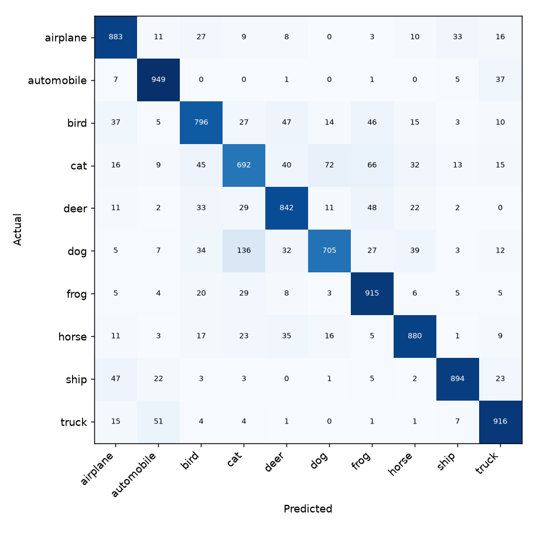

# Image Classification with a CNN

[](https://github.com/tanviwadgaonkar/image-classification/actions/workflows/ci.yml) [](https://github.com/tanviwadgaonkar/image-classification/actions/workflows/train-cifar10.yml)

**Status:** implemented and tested (13 tests on a synthetic dataset). Trained and evaluated on the real CIFAR-10 test set in CI. Not deployed.

A compact convolutional neural network (TensorFlow / Keras) that trains on any **folder-per-class** image dataset, evaluates on a held-out test set, and classifies single images. Trained and evaluated end to end on **CIFAR-10** in CI.

```
data/<dataset>/train/<class>/*.png ──tf.data (streamed, seeded 80/20 split)──┐
                                                                             ▼
          model: augmentation ─► rescale ─► 3 × [conv-BN-ReLU ×2 ─► pool] ─► GAP ─► dropout ─► softmax
                                                                             │  EarlyStopping (best val_loss)
                                                                             ▼
                       artifacts/model.keras + class_names.json + history.json
                                                                             │
data/<dataset>/test/<class>/ ──────────► evaluate ─► metrics.json (accuracy, macro-F1, per class) + confusion_matrix.png
image.jpg ─────────────────────────────► predict  ─► top-k classes with probabilities
```

## Results on CIFAR-10

Trained from scratch at 32×32 on the 50,000 training images (40,000 train / 10,000 validation split), evaluated once on the official **10,000-image test set**. Numbers come from [workflow run 40379035525](https://github.com/tanviwadgaonkar/image-classification/actions/runs/40379035525) on a GitHub-hosted CPU runner (1 h 49 min); the trained model is attached to that run as the `cifar10-model` artifact.

| Metric | Value |
|---|---|
| **Test accuracy** | **84.72 %** |
| Test macro-F1 | 0.846 |
| Validation accuracy (best epoch) | 84.95 % |
| Train accuracy (best epoch, with augmentation) | 88.30 % |
| Epochs | 40 of 40 (best: 35) |
| Parameters | < 400k |

| Class | Precision | Recall | F1 |
|---|---|---|---|
| airplane | 0.852 | 0.883 | 0.867 |
| automobile | 0.893 | 0.949 | 0.920 |
| bird | 0.813 | 0.796 | 0.804 |
| cat | 0.727 | 0.692 | 0.709 |
| deer | 0.830 | 0.842 | 0.836 |
| dog | 0.858 | 0.705 | 0.774 |
| frog | 0.819 | 0.915 | 0.864 |
| horse | 0.874 | 0.880 | 0.877 |
| ship | 0.926 | 0.894 | 0.910 |
| truck | 0.878 | 0.916 | 0.897 |



*Test-set confusion matrix (rows: actual, columns: predicted), from the run's `cifar10-model` artifact.*

**Reading the results.** Validation (84.95 %) and test (84.72 %) agree closely, and the 3.6-point gap to training accuracy shows only mild overfitting. Cat (F1 0.71) and dog (recall 0.71) are the weakest classes, and the confusion matrix below shows they mostly fail on each other: the largest single error is **dog predicted as cat (136 of 1,000 dogs)**, then cat predicted as dog (72). The next largest is truck predicted as automobile (51). Training used the full 40-epoch budget, and early stopping never triggered (best epoch 35), so a longer run may still gain a little. For context, this is a compact from-scratch CNN; much larger architectures and transfer learning reach well above 90 % on CIFAR-10.

## Limitations

- **Small, from-scratch CNN.** About 84.7 % on CIFAR-10 is a reasonable baseline, not state of the art. Transfer learning from an ImageNet backbone would be the obvious comparison; it is not done here.
- **CIFAR-10's test set has near-duplicates of training images** (Barz & Denzler, *Do we train on test data? Purging CIFAR of near-duplicates*, 2020), which inflates every model's test accuracy slightly. These numbers are not corrected for it.
- **One training run.** The 84.72 % comes from a single seed; run-to-run variance was not measured.
- **CPU training in CI** (1 h 49 min) limits how far the architecture and schedule can be explored on the free plan.

## Quick start

```bash
pip install -r requirements.txt

python scripts/export_cifar10.py --out data/cifar10          # 50k train / 10k test PNGs, folder per class
python -m src.train --data-dir data/cifar10/train --image-size 32 --batch-size 64 --epochs 40
python -m src.evaluate --model-dir artifacts --test-dir data/cifar10/test
python -m src.predict --model-dir artifacts some_photo.jpg
```

Any dataset laid out as `<root>/<class_name>/<image>` works the same way; use `--image-size 224` for photos.

## Tests

```bash
pip install -r requirements-dev.txt
pytest -q        # 13 tests
```

The suite generates a small synthetic dataset (red circles vs blue squares) and runs the real pipeline on it: image loading and error handling, class discovery, the train/validation split (disjoint, integer labels), model output shape and size, training to ≥ 90 % validation accuracy, held-out evaluation, and single-image prediction. CI fails if the TensorFlow tests are skipped.

## Design decisions

- **Preprocessing inside the model.** `Rescaling(1/255)` and the augmentation layers (flip, small rotation, zoom; active only during training) are part of the saved model, so `predict` feeds raw pixels exactly as training did — no separate preprocessing to keep in sync.
- **Global average pooling instead of Flatten.** At 224×224 the original `Flatten → Dense(64)` layer alone had ~12M parameters; the current model has under 400k in total at any input size, which overfits far less on small datasets.
- **Streaming input pipeline.** `image_dataset_from_directory` reads batches from disk with prefetching instead of loading every image into a NumPy array first, and produces the integer labels that `sparse_categorical_crossentropy` expects (the original code passed folder-name strings, which can't train).
- **Honest evaluation.** Early stopping and learning-rate decay watch the validation split carved from the training folder; the test folder is only used by `evaluate`, once.

## Layout

```
src/
  data_preprocessing.py  folder datasets (tf.data), single-image loading
  model.py               CNN with built-in rescaling and augmentation
  train.py               training CLI: early stopping, LR schedule, artifacts
  evaluate.py            test metrics + confusion matrix
  predict.py             top-k prediction for image files
scripts/export_cifar10.py
tests/                   pytest suite on a generated dataset
```
